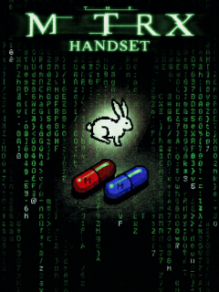

  # THE-MTRX-HANDSET
<table border="0" cellpadding="8" cellspacing="0">
  <tr>
    <td>
  

    <strong>Nokia 8110 4G slider firmware mod.</strong> 
    <em>Not a slow standalone phone—a Bluetooth accessory for a smartphone with the authentic feel of The Matrix. Expect envy from other fans.</em>
  

  

    
    

  

</td>
    <td>  
</td>
  </tr>
</table>

---

## The Premise

In 1999, *The Matrix* immortalized the curved, sliding **Nokia 8110**. In 2018, HMD Global revived the iconic silhouette with the **Nokia 8110 4G**. The hardware snap was there, but as a modern standalone phone, it makes little sense today: KaiOS is stagnant, typing on a numeric keypad is sluggish, and many units sit forgotten in drawers.

We aren't trying to build another slow feature phone. **We are transforming it into a dedicated, tactile Bluetooth audio companion for your modern smartphone.**

* **The Desk & Pocket Companion:** Pairs over Bluetooth to your daily smartphone (iOS or Android). When a call comes in—cellular, WhatsApp, Signal, or VoIP—snap the slider open and answer in retro style.
* **Pure Physical Control:** Take advantage of the physical slider and hardware keys to answer, talk, and hang up without touching glass.
* **Zero Carrier Hassles:** No separate SIM, no extra contract, and no dead app stores. It operates strictly as a dedicated Bluetooth audio accessory.
* **100% Stock Hardware:** Pure software mod via standard USB cable. No screws, no soldering, no 3D-printed brackets, and fully reversible to stock KaiOS.

---

## 🛠️ Architecture & Current Status

This project is an independent downstream distribution combining lightweight embedded Linux with a modern declarative UI:

* **Underlying Stack:** Powered by **[Alpine Linux](https://alpinelinux.org/)** for a minimal memory footprint on the Snapdragon 205 (MSM8905) and **[NuraOS](https://nura.eco/)** hardware adaptation roots.
* **Custom UI Layer:** Built with the lightweight **[Slint](https://slint.dev/)** UI toolkit + Python for snappy, low-latency rendering on the 2.4" display.
* **Flashing Pipeline:** Fastboot/ADB deployment targeting system and boot partitions without touching NVRAM/EFS, preserving your IMEI and radio calibration.
* **Audio & Bluetooth:** Low-latency voice routing through the native earpiece and microphones using modern Linux Bluetooth audio profiles (HFP/HSP).

### A Note on Development & Upstream NuraOS AI Policy

A significant portion of this companion firmware—including Bluetooth profile integration, audio duplex routing scripts, and interface glue—is developed using modern AI-assisted engineering workflows.

Upstream NuraOS maintains a strict contribution policy prohibiting AI-generated code. While we fully respect maintainers' prerogative to set their project's contribution rules, we do not align with blanket bans on AI-assisted tooling in open-source development.

Because we embrace AI-assisted programming to prototype and iterate rapidly, **this project operates entirely as a standalone, independent downstream distribution and will remain so until upstream contribution guidelines evolve**. All original licenses, attributions, and copyrights from upstream NuraOS and Alpine Linux remain strictly intact.

---

### Roadmap & Checklist
- [x] Reproducible Fastboot/ADB flashing routine
- [x] Stable Bluetooth Hands-Free Profile (HFP/HSP) pairing
- [x] Low-latency full-duplex earpiece & mic audio routing
- [x] *The Matrix* boot splash sequence
- [ ] Slint-based custom incoming call & status UI
- [ ] Automated call pick-up / hang-up tied directly to physical slider events
- [ ] Aggressive power management (selective peripheral sleep for long standby)
- [ ] Packaged, one-click installer workflow

---

## 📦 Requirements

1. **Nokia 8110 4G** (`nokia-argon` / standard HMD model).
2. **Standard Micro-USB data cable**.
3. **Host Machine:** A PC running Linux (Debian, Ubuntu, or Alpine recommended) with Fastboot and ADB installed.

---

## 🤝 Contributing

We welcome thoughtful contributions, bug fixes, and hardware testing.

* Please review our **[Contributing Guidelines](CONTRIBUTING.md)** before opening pull requests.
* All interactions and submissions are governed by our **[Code of Conduct](CODE_OF_CONDUCT.md)**.
* **Submissions Policy:** Contributions—whether created by humans, automated tools, or AI—must provide concrete utility, solve real problems, and be verified against physical hardware or a working build target. Unverified, purely cosmetic, or low-utility PRs will be closed without review.

---

## 🔒 Security

Due to limited resources, active security maintenance is provided **only for the `main` branch**. Official, final releases (releases not marked as pre-releases) will be published as stable milestones. If a non-pre-release build is found to contain a significant vulnerability, it will be clearly marked with a security notice or removed entirely. 

To report an issue, please open a ticket directly in the [Issue Tracker](../../issues). See **[SECURITY.md](SECURITY.md)** for details.

---

## 💚 Acknowledgements & Special Thanks

This project stands on the shoulders of the KaiOS modding and reverse-engineering community:

* **The [BananaHackers](https://bananahackers.net/) Community**: For maintaining the technical documentation, partition maps, and recovery archives that make independent development on `nokia-argon` possible.
* **GerdaOS**: For paving the way with custom firmware on the Nokia 8110 4G, open-source partition tooling, and the essential custom recovery environment.
* **Luxferre & the [Wallace Toolbox](https://gitlab.com/suborg/wallace-toolbox) Developers**: For pioneering root access.

---

## ⚖️ License & Disclaimers

* **Software & Codebase:** Distributed under the [GNU General Public License v3.0 or later (GPL-3.0-or-later)](LICENSE).
* **Upstream Attribution:**
  * **Alpine Linux:** Licensed under GPL-2.0 and permissive userland licenses.
  * **Slint:** Used under the GNU General Public License v3.0.
  * **NuraOS:** Upstream system components remain under their respective open-source licenses.
* **Fair Use & Trademarks:** This is an independent enthusiast project and is not affiliated with, sponsored by, or endorsed by HMD Global, Nokia, or Warner Bros. Entertainment Inc. All product names, logos, and trademarks are property of their respective owners.

