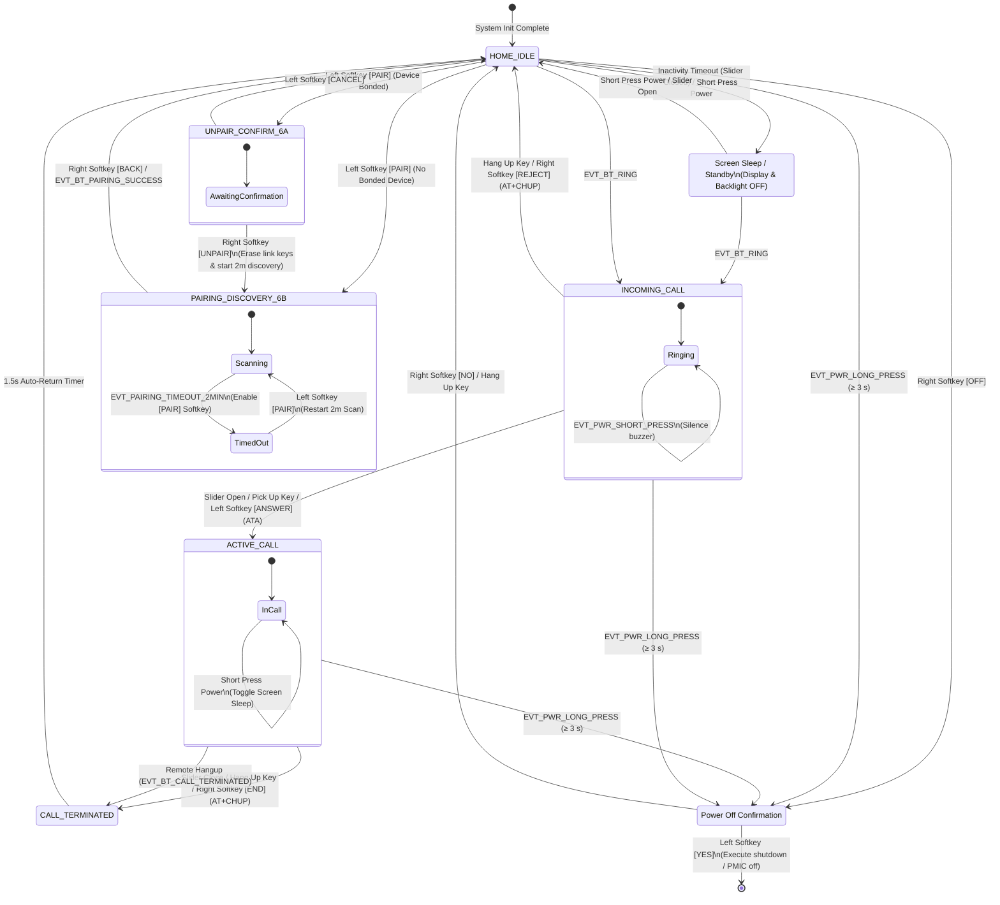

# PoC UI & State Machine Specification

## 1. System & Architecture Principles
* **Direct Initial State**: Hardware initialization transitions directly into `HOME_IDLE` (`EVT_BOOT_COMPLETE` is omitted; no timed splash screen).
* **Momentary Softkeys**: Softkeys decode strictly as momentary taps (`EVT_KEY_SOFT_LEFT`, `EVT_KEY_SOFT_RIGHT`) with no duration or long-press decoding.
* **Global Long-Press**: Physical Power button held for \\(\ge 3\text{ s}\\) (`EVT_PWR_LONG_PRESS`) acts as the single global long-press trigger across all screens to launch the Power Off confirmation dialog.
* **Slider Mechanics**:
  * **Open**: Wakes display, turns ON keypad backlight; auto-answers incoming calls (`ATA`).
  * **Close**: Turns OFF keypad backlight, starts display inactivity sleep countdown; auto-hangs up active calls (`AT+CHUP`).

---

## 2. Mermaid State Transition Diagram



---

## 3. Screen Specifications & Pseudographics Layouts

Display layout standard:
```text
+--------------------------------+
| [HEADER / STATUS]   [=== BAT =]| <- Status Bar (16 px)
+--------------------------------+
|                                |
|          BODY CONTENT          | <- Main Viewport (64–100 px)
|                                |
+--------------------------------+
| [LEFT SOFTKEY] [RIGHT SOFTKEY] | <- Softkey Navigation Bar (16 px)
+--------------------------------+
```

---

### Screen 1: Home / Idle Screen
* **Trigger**: Normal system standby state.
* **Layout**:
```text
+--------------------------------+
| [CONNECTED]        [=== BAT =] |
+--------------------------------+
|                                |
|             READY              |
|          SLIDER: OPEN          |
|                                |
+--------------------------------+
| [PAIR]                   [OFF] |
+--------------------------------+
```
* **Actions**:
  * **Left Softkey `[PAIR]`**: Evaluates bond state. If host is bonded, opens **Screen 6A (Unpair)**; if unbonded, starts inquiry scan and opens **Screen 6B (Pairing)**.
  * **Right Softkey `[OFF]`**: Opens **Screen 7 (Power Off Confirmation)**.
  * **Pick Up Key**: Initiates redial / test call (`ATD;`).
  * **Slider Open / Close**: Open wakes screen, enables keypad backlight; Close turns backlight off and arms sleep timer.
  * **Short Press Power**: Toggles display wake / sleep immediately.
  * **Long Press Power (\\(\ge 3\text{ s}\\))**: Opens **Screen 7 (Power Off Confirmation)**.

---

### Screen 2: Incoming Call Screen
* **Trigger**: Host signals an inbound call (`EVT_BT_RING`).
* **Layout**:
```text
+--------------------------------+
| [INCOMING CALL]    [=== BAT =] |
+--------------------------------+
|        *** RINGING ***         |
|                                |
|        +46 70 123 4567         |
|                                |
+--------------------------------+
| [ANSWER]              [REJECT] |
+--------------------------------+
```
* **Actions**:
  * **Slider Open**: Auto-answers call (`ATA`), turns ON keypad backlight, transitions to **Screen 3 (Active Call)**.
  * **Left Softkey `[ANSWER]` / Pick Up Key**: Answers call (`ATA`), transitions to **Screen 3 (Active Call)**.
  * **Right Softkey `[REJECT]` / Hang Up Key**: Rejects call (`AT+CHUP`), returns to **Screen 1 (Home / Idle)**.
  * **Short Press Power**: Silences local buzzer/melody.

---

### Screen 3: Active Call Screen
* **Trigger**: Audio channel open (`EVT_BT_CALL_ACTIVE`).
* **Layout**:
```text
+--------------------------------+
| [IN CALL]          [=== BAT =] |
+--------------------------------+
| +46 70 123 4567                |
| SINK: EARPIECE                 |
| VOL:  [========····] (65%)     |
| SLIDER: OPEN                   |
+--------------------------------+
| [SPKR]                   [END] |
+--------------------------------+
```
* **Actions**:
  * **Left Softkey `[SPKR]` / `[EAR]`**: Toggles audio sink between internal earpiece and loudspeaker amplifier.
  * **Right Softkey `[END]` / Hang Up Key**: Terminates call (`AT+CHUP`), transitions to **Screen 4 (Call Terminated)**.
  * **Volume Up / Down**: Increments/decrements volume for the active sink; refreshes volume gauge immediately.
  * **Slider Close**: Auto-hangup (`AT+CHUP`), turns OFF keypad backlight, transitions to **Screen 4 (Call Terminated)**.
  * **Short Press Power**: Toggles display sleep/wake.

---

### Screen 4: Call Terminated Screen
* **Trigger**: Call termination (`EVT_BT_CALL_TERMINATED` or local hangup).
* **Layout**:
```text
+--------------------------------+
| [CALL ENDED]       [=== BAT =] |
+--------------------------------+
|                                |
|           CALL ENDED           |
|                                |
+--------------------------------+
|                                |
+--------------------------------+
```
* **Actions**:
  * Auto-holds for 1.5 seconds via `EVT_CALL_ENDED_AUTO_RETURN`, then returns to **Screen 1 (Home / Idle)**. If the slider is closed, the display sleeps immediately.

---

### Screen 5: Bluetooth Unpair Confirmation (6A)
* **Trigger**: Pressing `[PAIR]` from Home when a paired host exists in storage.
* **Layout**:
```text
+--------------------------------+
| BLUETOOTH          [=== BAT =] |
+--------------------------------+
| Paired to:                     |
| Pixel 8 Pro                    |
| Unpair to continue?            |
+--------------------------------+
| [CANCEL]              [UNPAIR] |
+--------------------------------+
```
* **Actions**:
  * **Left Softkey `[CANCEL]`**: Aborts without modifying pairing keys; returns safely to **Screen 1 (Home / Idle)**.
  * **Right Softkey `[UNPAIR]`**: Calls BlueZ `RemoveDevice`, clears keys, and transitions to **Screen 6B (Pairing)**.

---

### Screen 6: Bluetooth Pairing Discovery (6B)
* **Trigger**: Entered after unpairing (6A) or directly if no host is bonded.
* **Discovery Active (0–120 seconds)**:
```text
+--------------------------------+
| PAIRING            [=== BAT =] |
+--------------------------------+
| Discoverable as:               |
| "BananaPhone"                  |
| Waiting for phone...           |
+--------------------------------+
| (Pair)                  [BACK] |
+--------------------------------+
```
*(Left Softkey `(Pair)` is disabled and muted during the active scan window).*

* **Discovery Timed Out (After 120 seconds)**:
```text
+--------------------------------+
| PAIRING            [=== BAT =] |
+--------------------------------+
| Pairing timed out.             |
| Press Pair to retry.           |
|                                |
+--------------------------------+
| [PAIR]                  [BACK] |
+--------------------------------+
```
*(Left Softkey `[PAIR]` becomes enabled to re-arm the 2-minute discovery scan).*

* **Actions**:
  * **Left Softkey `[PAIR]`**: Disabled during active scan; enabled upon timeout to restart inquiry scan.
  * **Right Softkey `[BACK]`**: Halts inquiry scan; returns to **Screen 1 (Home / Idle)**.
  * **Host Pairing Request**: Auto-accepted via BlueZ ("Just Works"); on completion, flashes confirmation and returns to **Screen 1 (Home / Idle)**.

---

### Screen 7: Power Off Confirmation
* **Trigger**: Right Softkey `[OFF]` on Home screen or `EVT_PWR_LONG_PRESS` (\\(\ge 3\text{ s}\\)).
* **Layout**:
```text
+--------------------------------+
| POWER OFF          [=== BAT =] |
+--------------------------------+
|                                |
|        Power off system?       |
|                                |
+--------------------------------+
| [YES]                     [NO] |
+--------------------------------+
```
* **Actions**:
  * **Left Softkey `[YES]`**: Triggers clean OS shutdown (`systemctl poweroff` / PMIC power-hold release).
  * **Right Softkey `[NO]` / Hang Up Key**: Aborts dialog; returns to previous active screen.

---

## 4. PoC Controls & Action Matrix

| Screen | Left Softkey Tap | Right Softkey Tap | Slider Action | Dedicated Keys |
| :--- | :--- | :--- | :--- | :--- |
| **1: Home / Idle** | `[PAIR]` (Open 6A/6B) | `[OFF]` (Open 7) | **Open**: Wake + Backlight ON<br>**Close**: Backlight OFF + Sleep timer | **Pick Up**: Redial (`ATD;`)<br>**Power \\(\ge 3\text{s}\\)**: Open 7 |
| **2: Incoming Call**| `[ANSWER]` (`ATA`) | `[REJECT]` (`AT+CHUP`) | **Open**: Auto-Answer (`ATA`)<br>**Close**: Silences ring | **Pick Up**: Answer (`ATA`)<br>**Hang Up**: Reject (`AT+CHUP`)<br>**Power Tap**: Silence ring |
| **3: Active Call** | `[SPKR]` / `[EAR]` (Toggle sink) | `[END]` (`AT+CHUP`) | **Open**: Keep call awake<br>**Close**: Auto-Hangup (`AT+CHUP`) | **Hang Up**: End (`AT+CHUP`)<br>**Vol +/-**: Active sink gain<br>**Power Tap**: Sleep toggle |
| **4: Call Ended** | *(Inactive)* | *(Inactive)* | **Close**: Immediate sleep | Auto-returns after 1.5s |
| **5: Unpair (6A)** | `[CANCEL]` (Safe exit) | `[UNPAIR]` (Clear keys \\(\rightarrow\\) 6B) | *(No effect)* | **Hang Up**: Cancel \\(\rightarrow\\) Home |
| **6: Pairing (6B)** | `[PAIR]` (Active after timeout) | `[BACK]` (Halt \\(\rightarrow\\) Home) | *(No effect)* | **Hang Up**: Back \\(\rightarrow\\) Home |
| **7: Power Off** | `[YES]` (Shut down system) | `[NO]` (Cancel \\(\rightarrow\\) Home) | *(No effect)* | **Hang Up**: Cancel \\(\rightarrow\\) Home |